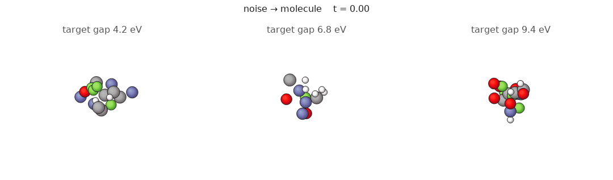
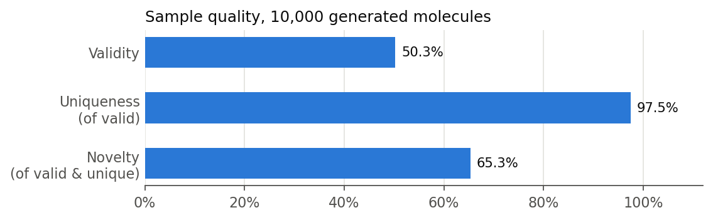
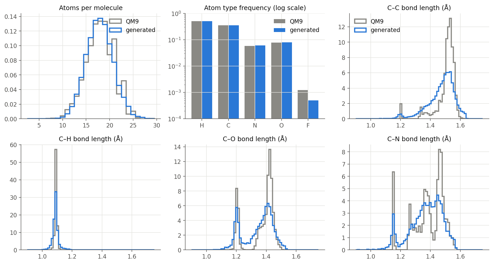
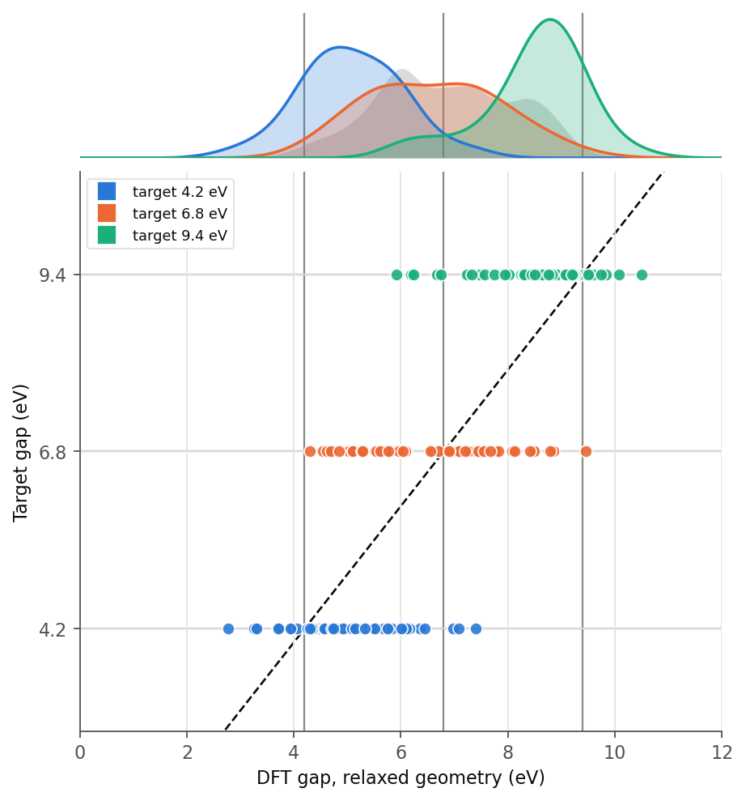

# nano-flow

**A minimal flow-matching model that generates 3D molecules with a target HOMO-LUMO gap, validated with DFT.**

<p align="center">
  
</p>

nano-flow is ~600 lines of PyTorch and a 1M-parameter model that trains in ~2 h on a single GPU. It generates QM9-like molecules (atom types and 3D coordinates) for a requested HOMO-LUMO gap. We then check the generated molecules with DFT at the same level of theory used to build QM9, B3LYP/6-31G(2df,p). The three molecules above were generated for 4.2, 6.8 and 9.4 eV and have DFT gaps of 4.25, 6.70 and 9.39 eV.

## 1. Data and model

We train on [QM9](https://doi.org/10.6084/m9.figshare.c.978904.v5): 133,885 small organic molecules with up to 9 heavy atoms (C, N, O, F) plus hydrogens, with B3LYP/6-31G(2df,p) geometries and properties. Each molecule is a point cloud of positions $x \in \mathbb{R}^{N\times 3}$ and one-hot atom types $h \in \{0,1\}^{N\times 5}$. We use a fixed seeded split (113,803 train / 6,694 val / 13,388 test).

The model learns a velocity field $v_\theta$ that moves atoms from noisy starting postions to valid positions, forming a molecule:

$$x_t = t\,x_1 + (1-t)\,x_0,\qquad h_t = t\,h_1 + (1-t)\,h_0,\qquad x_0 \sim \mathcal{N}(0, \sigma^2 I),\ h_0 \sim \mathcal{N}(0, I)$$

$$\mathcal{L} = \mathbb{E}_{t, x_0, x_1}\,\big\lVert v^x_\theta(x_t, h_t, t, y) - (x_1 - x_0)\big\rVert^2 + \big\lVert v^h_\theta(x_t, h_t, t, y) - (h_1 - h_0)\big\rVert^2$$

The network is a 6-layer [EGNN](https://arxiv.org/abs/2102.09844) on the fully connected graph, so coordinate updates are E(3)-equivariant. The gap $y$ is embedded together with the time $t$ and injected into every layer. A small MLP predicts the number of atoms from $y$, so molecule size also follows the requested gap. To sample, we integrate $dx/dt = v_\theta$ from $t=0$ to $1$ with 100 Euler steps.

## 2. Training

The model is trained for 500 epochs and keep an exponential moving average of the weights for sampling.

The trained model is included in `checkpoints/` and is used for all results below.

## 3. Sample quality

We generate 10,000 molecules with gaps drawn from the training distribution.

<p align="center"></p>

Half of the molecules are valid, almost all valid molecules are unique, and two thirds of them are not in the training set. Novelty is computed by comparing SMILES with the QM9 SMILES strings.

The atom count and atom types match QM9 closely.

<p align="center"></p>

## 4. DFT validation

For each target gap (4.2, 6.8 and 9.4 eV, i.e. QM9 mean and ±2σ) we generate 3,000 molecules, keep the first 64 stable and unique ones, pre-relax them with MMFF94, optimize them with B3LYP/6-31G(2df,p) and compute the HOMO-LUMO gap with [GPU4PySCF](https://github.com/pyscf/gpu4pyscf). All 192 molecules converged.

<p align="center"></p>

Each point is one molecule: x is its DFT gap after relaxation and y the gap we asked for, so points on the dashed line hit the target. The top panel shows the DFT gap distribution for each target on top of the whole of QM9 (gray).

## Quickstart

Generate molecules with the pretrained model right away, no dataset needed:

```bash
conda env create -f environment.yml && conda activate nanoflow
python generate.py --run_dir checkpoints --gap 5.0 --num_mols 10   # writes generated/*.xyz
```

Reproduce everything from scratch:

```bash
python download_dataset.py                  # QM9 -> data/qm9/raw
python data.py                              # process + seeded split

python train.py                             # ~2 h on one GPU -> results/run_<date>/

python evaluate.py                          # metrics + distributions -> results/run_<date>/eval/
python scripts/plot_metrics.py              # assets/metrics.png

python dft_eval.py --calibrate 5            # check PySCF reproduces QM9 gaps
python dft_eval.py                          # DFT on generated molecules (resumable, --shard i/k)
python scripts/plot_dft.py                  # assets/dft_eval.png
python scripts/make_movie.py                # assets/generation.gif from DFT-verified molecules
```

## Repository layout

| File | Purpose |
|---|---|
| `data.py` | QM9 parsing, dataset, seeded split |
| `model.py` | EGNN velocity field and size predictor |
| `fm.py` | flow matching: training paths and Euler sampling |
| `train.py` | training loop with EMA and checkpoints |
| `generate.py` | sampling CLI and helpers |
| `chem.py` | bond perception, stability, validity, RDKit conversion |
| `evaluate.py` | sample-quality metrics and distributions |
| `dft_eval.py` | MMFF + B3LYP/6-31G(2df,p) relaxation and gaps with PySCF |
| `regressor.py` | optional EGNN gap predictor (not used for the results above) |
| `scripts/` | figures and the generation GIF |
| `checkpoints/` | pretrained model (`best.pt`) and its `config.json` |

## License

MIT
